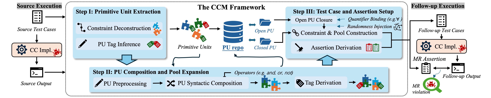

# CCMed: Metamorphic Testing Framework for Constraint Checking Implementations

**CCMed** is an automated testing framework designed to test constraint checking implementations. It is the artifact of the paper 

*"Compositional Constructive Metamorphism for Testing Constraint Checking Implementations"* 

in Proceedings of the 37th International Symposium on Software Reliability Engineering (ISSRE 2026, forthcoming).

It leverages the core structure of Primitive Units, building blocks extracted from executed source test cases, to generate follow-up test cases. That makes a traditional MR catalog unnecessary, as the framework can automatically generate diverse and complicated follow-up test cases.



## 🚀 Getting Started

### Prerequisites

*   **Java Development Kit (JDK) 21** or higher.
*   **Gradle** (Wrapper included).

### Installation

1.  Clone the repository:
    ```bash
    git clone https://github.com/your-repo/CCTester.git
    cd CCTester
    ```

2.  Build the project:
    ```bash
    ./gradlew build
    ```

### Configuration

The execution is controlled by `config.json`. Key parameters include:

*   `taskName`: Identifier for the test run.
*   `sourceLimit`: Number of source cases to generate.
*   `followUpLimit`: Number of follow-up cases to generate.
*   `workerType`: The type of SUT worker (e.g., `infuse`, `cmid`).
*   `targetPath`: Path to the SUT executable or library.
*   `rulesPath`: Directory containing XML rule templates.
*   `bfuncPath`: Path to the Bfunction support class.

> [!NOTE] Bfunction Support Class
> The `bfuncPath` is only required if the SUT / SUT worker uses Bfunction support to read the generated `bfunc_in.txt` and instantiate Bfunctions. However, it is a required parameter because mainstream CC implementations and their workers (e.g., Infuse, MG) use Bfunction support class. If the SUT / SUT worker does not use Bfunction support, you can set `bfuncPath` to an empty string `""`.

A example configuration file can be found in `conf/rt_conf.json`, which is for running the framework with a small number of source and follow-up cases for regression testing.

### Usage

#### CLI Mode
Run the tester using the default configuration (`config.json`):
```bash
./gradlew run
```

Or specify a custom configuration file:
```bash
./gradlew run --args="-c my_config.json"
```

## 🔌 Integrating a New CC Implementation

We recommend that the SUT (the constraint checking tool under test) adopt one of two standard command-line interfaces so it can be tested with zero or minimal worker code:

### Standard interface (recommended for new integrations)

```bash
java -jar cc.jar -rules <rule.xml> -bfuncs <bfunc_in.txt> -contextpool <ctx.json> -incs <incs.json>
```

| Flag | Argument | Description |
|------|----------|-------------|
| `-rules` | `rule.xml` | Generated constraint rule in XML |
| `-bfuncs` | `bfunc_in.txt` | Boolean function definitions (see `utils/Bfunction.java`) |
| `-contextpool` | `ctx.json` | Pattern context data |
| `-incs` | `incs.json` | **Output** — write inconsistencies result here |

Use `"workerType": "standard"` in your config.

### Infuse interface (compatible)

```bash
java -jar cc.jar -test -rules <rule.xml> -bfuncs <bfunc_in.txt> -contextpool <ctx.json> -incs <incs.json> -cct <cct.txt>
```

Extra flags: `-test` enables test mode, `-cct` outputs the CCT trace.

Use `"workerType": "infuse"` in your config.

### Result format

The SUT should write a JSON object to `-incs` with the following structure:

```json
{
  "<ruleId>": {
    "truth": true,
    "links": [
      [ {"var": "x", "value": {"fields": {"data": "0"}} }, ... ]
    ]
  }
}
```

If your SUT uses a different CLI or output format, write a [custom worker](#-custom-workers).

## 🔌 Custom Workers

To test a new SUT, implement a custom worker. Two approaches:

### Option 1: Extend `StandardWorker` (recommended)

Override `getCmdLine` to define how your SUT is invoked:

```java
package com.example;

import com.wenzejin.core.worker.StandardWorker;
import java.nio.file.Path;
import java.util.*;

public class MyWorker extends StandardWorker {
    public MyWorker(String workspace, Map<String, Object> args) {
        super(workspace, args);
    }

    @Override
    protected List<String> getCmdLine(Path target, Path rule, Path cp,
                                       Path bfc, Path bf, Path inc,
                                       List<String> args) {
        return new ArrayList<>(List.of(
            "java", "-jar", target.toString(),
            "--rule", rule.toString(),
            "--context", cp.toString(),
            "--bfuncs", bf.toString(),
            "--output", inc.toString()
        ));
    }
}
```

### Option 2: Implement `TestWorker` directly

For SUTs that need full control over workspace setup and result parsing.

### Usage

Place the worker jar on the classpath, then set `workerType` in your config to the fully-qualified class name:

```json
{
  "workerType": "com.example.MyWorker",
  ...
}
```

Built-in worker names (`infuse`, `standard`, `mg`, `cmid`, `infuse-old`) are also supported.

> [!NOTE] 
> Custom workers are instantiated via reflection. The class must have a public constructor `(String workspace, Map<String, Object> arguments)` and implement `TestWorker`.

## 📄 Citation

*(Note: Citation details to be updated upon publication)*

