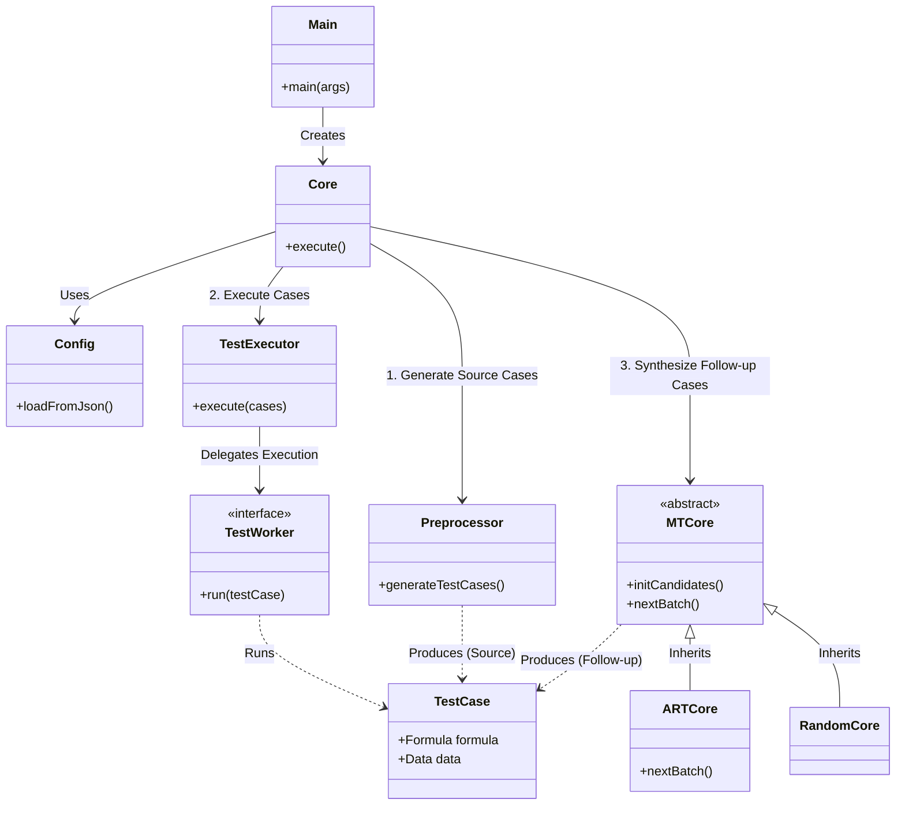

# CCTester: Semantic-Guided Constructive Metamorphic Testing Framework

**CCTester** is an automated testing framework designed to verify logical evaluation systems (such as rule engines, model checkers, or complex business logic components). It introduces a novel approach called **Semantic-Guided Constructive Metamorphism (SGCM)** to detect deep logical flaws by synthesizing complex test scenarios from basic semantic primitives.

## 📖 Core Philosophy: SGCM

Unlike traditional Metamorphic Testing (MT) which mutates inputs ($Input_A \xrightarrow{mutation} Input_B$), **SGCM** adopts a bottom-up, constructive approach ($Component_A + Component_B \xrightarrow{logic} Input_{New}$).

1.  **Semantic Extraction**: Executes source test cases to extract logic fragments and captures their execution results as **Semantic Tags**.
2.  **Semantic Flow**: These tags transform static formulas into dynamic **Semantic Primitives**, preserving the SUT's behavioral state.
3.  **Constructive Synthesis**: Complex follow-up cases are synthesized using these primitives. The expected behavior (Oracle) is logically derived from the preserved tags.

## ✨ Features

*   **Logic-Based Verification**: Uses logical consistency as the test oracle.
*   **Adaptive Random Testing (ART)**: Intelligently explores the testing space to maximize diversity.
*   **Modular Architecture**: Decoupled design allowing easy adaptation to different Systems Under Test (SUT).
*   **Dual Mode**: Supports both Command Line Interface (CLI) and Graphical User Interface (GUI).

## 🛠️ Architecture

The project follows a layered architecture:

*   **Core Control Layer** (`com.wenzejin.core`): Coordinates workflow, configuration, and rule parsing.
*   **Data Model Layer** (`com.wenzejin.core.rule`, `com.wenzejin.core.cases`): Defines the AST of logical formulas and test case structures.
*   **Algorithmic Strategy Layer** (`com.wenzejin.core.mr`): Implements ART and Random strategies for case synthesis.
*   **Execution Abstraction Layer** (`com.wenzejin.core.worker`): Interfaces with the SUT.

## 🚀 Getting Started

### Prerequisites

*   **Java Development Kit (JDK) 21** or higher.
*   **Gradle** (Wrapper included).

### Installation

1.  Clone the repository:
    ```bash
    git clone https://github.com/your-repo/CCTester.git
    cd CCTester
    ```

2.  Build the project:
    ```bash
    ./gradlew build
    ```

### Configuration

The execution is controlled by `config.json`. Key parameters include:

*   `taskName`: Identifier for the test run.
*   `ART`: Enable/Disable Adaptive Random Testing.
*   `sourceLimit`: Number of source cases to generate.
*   `followUpLimit`: Number of follow-up cases to synthesize.
*   `workerType`: The type of SUT worker (e.g., `infuse`, `cmid`).
*   `targetPath`: Path to the SUT executable or library.
*   `rulesPath`: Directory containing XML rule templates.

Example `config.json`:
```json
{
  "taskName": "test_run_01",
  "ART": true,
  "sourceLimit": 500,
  "followUpLimit": 1000,
  "workerType": "infuse",
  "targetPath": "cc_utils/INFUSE_ORI/531.jar",
  "rulesPath": "rules/level3all"
}
```

### Usage

#### CLI Mode
Run the tester using the default configuration (`config.json`):
```bash
./gradlew run
```

Or specify a custom configuration file:
```bash
./gradlew run --args="-c my_config.json"
```

Enable follow-up detail data export:
```bash
./gradlew run --args="-c my_config.json --detail-data"
```

`--detail-data` is optional. When enabled, it writes `detail-data.txt` into the job workspace directory
(the same directory as `result.json`). One line per follow-up case in the format:
`durationMs<TAB>sourceRootType<TAB>followUpRootType`

#### GUI Mode
Launch the graphical interface:
```bash
./gradlew run --args="-g"
```

## 📂 Project Structure

The project is organized into a modular structure to separate concerns between control logic, data models, execution strategies, and system interfaces.

```
src/main/java/com/wenzejin/
├── Main.java                   # Application Entry Point (CLI argument parsing)
├── core/                       # Core Logic Layer
│   ├── Core.java               # Main controller: orchestrates the testing workflow
│   ├── Config.java             # Configuration management (loads config.json)
│   ├── Preprocessor.java       # Handles rule parsing and source case generation
│   ├── TestExecutor.java       # Manages concurrent test execution
│   ├── WorkspaceManager.java   # Manages output directories and logs
│   ├── rule/                   # Data Model: Logic Formula AST
│   │   ├── Formula.java        # Abstract base class for logic formulas
│   │   ├── Rule.java           # Represents a complete rule definition
│   │   ├── Bfunc.java          # Boolean Function primitives
│   │   ├── OpConnector.java    # Logical operators (AND, OR, IMPLIES, etc.)
│   │   └── OpQuantifier.java   # Quantifiers (FORALL, EXISTS)
│   ├── cases/                  # Data Model: Test Cases
│   │   └── TestCase.java       # Encapsulates a test scenario (Source or Follow-up)
│   ├── worker/                 # Execution Abstraction Layer (SUT Interface)
│   │   ├── TestWorker.java     # Interface for SUT adapters
│   │   ├── InfuseWorker.java   # Adapter for 'Infuse' system
│   │   └── CMIDWorker.java     # Adapter for 'CMID' system
│   └── mr/                     # Algorithmic Strategy Layer
│       ├── MTCore.java         # Abstract base for Metamorphic Testing strategies
│       ├── jin/                # SGCM Implementation
│       │   ├── ARTCore.java    # Adaptive Random Testing strategy
│       │   ├── RandomCore.java # Random strategy
│       │   └── FormulaWithTag.java # Semantic Primitive (Formula + Execution Tag)
│       └── assertion/          # Oracle Definitions
│           └── TestAssertion.java # Defines how to verify test results
└── gui/                        # Graphical User Interface
    ├── MainGUI.java            # Main window entry
    └── ConfigPanel.java        # Configuration UI
```

## 🏗️ Architecture

The following diagram illustrates the high-level architecture and the interaction between key components of CCTester.



### Workflow Description

1.  **Initialization**: `Core` loads settings via `Config` and sets up the workspace.
2.  **Source Generation**: `Preprocessor` reads XML rule templates and generates a batch of **Source Cases**.
3.  **Source Execution**: `TestExecutor` dispatches these cases to the SUT via a specific `TestWorker` (e.g., `InfuseWorker`).
4.  **Semantic Analysis**: The execution results are fed into `MTCore` (specifically `ARTCore` or `RandomCore`).
5.  **Synthesis (SGCM)**: `MTCore` converts source cases into **Semantic Primitives** (`FormulaWithTag`) and synthesizes complex **Follow-up Cases** based on the selected strategy.
6.  **Verification**: `TestExecutor` runs the follow-up cases, and their results are compared against the logically derived expected values.


## 📄 Citation

If you use CCTester or the SGCM approach in your research, please cite our paper:

```bibtex
@inproceedings{CCTester2025,
  title={Semantic-Guided Constructive Metamorphism for Logic Verification},
  author={Jin, Wenze and [Co-authors]},
  booktitle={[Conference Name]},
  year={2025}
}
```

*(Note: Citation details to be updated upon publication)*

